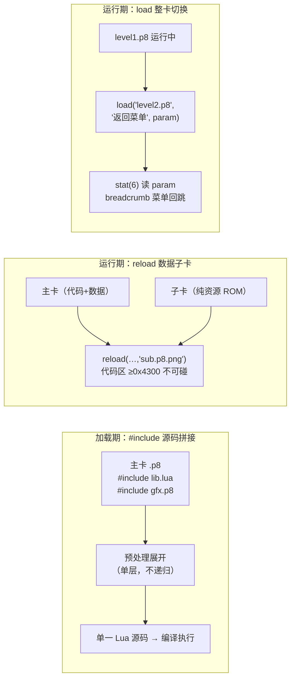

# PICO-8「多卡带 + 外部 Lua」机制与各模拟器支持调研

状态：**已完成** · 日期：2026-10-21
范围：官方 PICO-8（以 pico-ios 内置的 **0.2.7 官方引擎**为准）、`fake-08`、`zepto8`、`jsgs`、`pico-ios (Pocket8)`、`z8lua`，并对照本项目 `p8js` 的现状。
所有代码结论均带 `file:line`；官方行为结论来自**解码官方引擎内置字符串**（取证方法见附录 A）。

---

## 1. 结论速览

真实游戏看起来是「很多 card（卡带文件）+ 外部 lua 脚本拼在一起」，背后其实是官方支持的**三套互补机制**：

1. **`#include` —— 加载期的源码拼接**（外部 `.lua`，以及在部分实现中还包括其他 `.p8` 卡的代码段）。
   - 官方引擎内置了 `"#include "` 指令字符串和 `"can not #include"` 错误；
   - 导出为 `.p8.png` 时 include 会被**扁平化（flatten）烘焙进单文件**——所以 BBS/itch 上分发的游戏永远是自包含单卡，多文件结构只存在于开发仓库里。
2. **`reload(dest, src, len, [fn])` / `cstore(...)` —— 运行期跨卡带搬数据**（官方内置帮助原文："when filename fn is given, data is read from a separate cartridge file."）。
   - 资源层面的「多张卡带组合」：**主卡装代码，子卡装美术/地图/音效**，运行时按需 `reload(fn)` 拉进来。
   - 代码区（≥ 0x4300）被官方保护，reload/cstore **不能**跨卡带读写代码——换数据用 reload，换逻辑用下面的 `load`。
3. **`load(filename, [breadcrumb], [param_str])` —— 运行期整卡切换（代码级多卡带）**（官方内置帮助原文："when called from a running program, the loaded cartridge is immediately run with param_str (accessible with stat(6)) and a menu item with the label breadcrumb is inserted, allowing the user to return to the previous cart."）。
   - 关卡/章节拆成多张卡的游戏用它：跑完主卡 `load("level2.p8")` 切走，breadcrumb 菜单项可以**回到上一张卡**；`stat(6)` 读参数；`#` 开头的文件名按 BBS 卡带 id 解析。

支持矩阵（✅ 支持 / ⚠️ 部分 / ❌ 不支持 / — 不适用）：

| 实现 | `#include` 外部文本 | include 其他 `.p8` | `.p8.png` 卡里的 include | `reload([fn])` 数据子卡 | `load()` 整卡切换 | 关键限制 |
|---|---|---|---|---|---|---|
| **官方 PICO-8 0.2.7** | ✅（引擎字符串实证） | ？未验证 | 导出时已 flatten | ✅（引擎帮助原文实证） | ✅（引擎帮助原文实证） | 路径基准 / 递归等细节未验证 |
| **zepto8** | ✅ `cart.cpp:528` | ✅ `cart.cpp:567` | ✅ `vm.cpp:528` | ✅ `vm.cpp:571` | ✅ `vm.h:196,363`（`__load`） | 缺文件只**警告并跳过**，不失败 |
| **fake-08** | ✅ 仅 `.p8` 文本卡 `cart.cpp:346` | ❌ 原样粘贴 | ❌ 完全不处理 | ✅ `vm.cpp:1098` | ✅ `vm.cpp:1328` | 缺文件 = **整卡加载失败**；`cstore` 是空实现 |
| **jsgs** | ❌ | ❌ | ❌ | ❌ | ❌ | 2016 年 WIP，只有单卡 URL 加载 |
| **pico-ios (Pocket8)** | ✅ = 官方 | = 官方 | = 官方 | ✅ = 官方 | ✅ = 官方 | 手机上只导入单个 `.p8.png`，伴随文件不存在时会报 `can not #include` |
| **z8lua** | — | — | — | — | — | 纯语言层，不含 include（不是模拟器职责） |
| **p8js（本项目）** | ✅ 转换期展开 `convert.ts:168` | ✅ `include.ts:17` | ✅ 转换期展开 | ❌ 未实现 | ❌ 未实现 | 已按 zepto8 语义移植 |



---

## 2. 官方 PICO-8 的三套机制（0.2.7 引擎实证）

### 2.1 `#include`：加载期源码拼接

从官方引擎（pico-ios `public/pico8.js` 的 `memoryInitializer` base64 解码，共 104,879 字节）中找到的直接证据：

```
== 引擎版本串 ==
pico-8 0.2.7
(c) 2014-25 lexaloffle games llp

== 指令与错误 ==
#include            ← 扫描用的指令字面量（带尾随空格）
can not #include    ← 官方错误信息（不带文件名参数）

== 保存/导出相关 ==
... to be exported or saved as png
(saving .p8 anyway)
flattened #includes
** failed to save **
```

解读：

- 官方引擎**确实实现**了 `#include` 指令——这不是克隆项目自行发挥。
- **导出扁平化**：卡带代码过大无法存成 `.p8.png` 时，会提示 `(saving .p8 anyway)` 和 `flattened #includes`——即 **png 导出会把 include 展开后的源码烘焙进去**。这解释了为什么 BBS 上下载到的游戏都是单文件自包含，而 GitHub 上的开发仓库却是「一堆 `.p8` + 一堆 `.lua` + include 行」的结构。
- 未在引擎里找到 `#include` 的帮助文档条目（`?help` 内容里没有），所以官方手册/wiki 是语义细节的唯一权威来源——**本次网络无法访问 pico-8.com / fandom wiki，细节以两个克隆实现为准并明确标注不确定**（见 §5）。

### 2.2 `reload` / `cstore`：跨卡带搬数据（官方帮助原文）

同一镜像中解出的引擎内置帮助（逐字）：

```
reload
. reload(dest, src, len, [fn])
similar to memcpy, but read
from cartridge rom and write
to ram at dest for len bytes.
reload() reloads everything.
the code section (>= 0x4300)
is protected and can not be
accessed by reload / cstore.
when filename fn is given,
data is read from a separate
cartridge file.

cstore
. cstore(dest, src, len, [fn])
from ram and write to cart rom
at dest for len bytes.
cstore() stores everything in
ram back to the cartridge.
```

要点：

1. 第 4 个参数 `[fn]` 是**另一张卡带的文件名**——这就是官方的「多卡带（multicart）」机制。
2. **代码区（地址 ≥ 0x4300）被保护**，reload/cstore 都不能访问 → 游戏逻辑代码只能来自主卡；子卡只能贡献 `0x0000–0x42ff`（gfx/map/sfx/music 等资源区）。
3. 无参 `reload()` 重载全部资源（默认长度 0x4300，恰好到代码区为止——fake-08 的 `len = 0x4300` 默认值与之吻合）。
4. reload/cstore 管不了代码，但**代码级的多卡带由 `load()` 承担**（见 §2.3）。`folder` 之类则是控制台功能（fake-08 里是 stub，`p8GlobalLuaFunctions.h:392`）。

### 2.3 `load()`：运行期整卡切换（同一镜像解出的帮助原文）

```
load
. > load filename
   load(filename, [breadcrumb],
   [param_str])
load a cartridge. when called
from a running program, the
loaded cartridge is immediately
run with param_str (accessible
with stat(6)) and a menu item
with the label breadcrumb is
inserted, allowing the user to
return to the previous cart.
filenames starting with # are
taken to be bbs cartridge ids.
```

解读：

- **游戏代码在运行中就能切换到另一张卡带**（加载即运行），所以「多张 `.p8` 卡串成一个大游戏」在官方是完全合法的玩法：数据用 `reload(fn)`，整卡（含代码）用 `load(fn)`。
- `breadcrumb` 会在系统菜单里插入「返回上一张卡」的条目——多卡链不会把玩家锁死。
- `param_str` 通过 `stat(6)` 传给新卡；`#xxx` 按 BBS 卡带 id 解析（要联网）。
- zepto8 的 `api.cpp:34-61` 注释明确写着「The official API. Anything not in this list may still exist in the Lua runtime, but will be hidden from user cartridges.」，`load` 就列在其中——与引擎帮助互为印证。

### 2.4 「真实游戏为什么长这样」——工程形态总结

| 阶段 | 形态 | 机制 |
|---|---|---|
| 开发仓库 | 主 `game.p8` + `lib/*.lua` + 资源子卡 `*.p8` | `#include` 引用外部文件 |
| 导出分发 | 单个 `.p8.png` | 导出时 include **flatten** 进源码 |
| BBS 运行 | 单文件 | 无需伴随文件 |
| 大型游戏运行期 | 主卡 + 数据子卡 | `reload(dest,src,len,fn)` 按需拉取资源 |
| 关卡/章节式游戏运行期 | 多张代码卡串联 | `load(fn, breadcrumb, param)` 整卡切换，`stat(6)` 传参，菜单可回跳 |

---

## 3. 各实现逐家取证

### 3.1 zepto8 —— 最完整

**`#include`：`src/pico8/cart.cpp:528-585`（`cart::preprocess_code()`）**

- `:531` 快速路径：源码不含 `"#include "` 直接返回。
- `:547-582` 逐行处理；`:549-552` 触发条件：行内找到 `#include `，且该行**不含引号也不含 `--`**（用来排除字符串/注释里的假指令——副作用：`#include x -- 注释` 和 `#include "x.lua"` 这两种写法都不会展开）。
- `:555-556` 路径基准 = 卡带文件名的目录部分。
- `:559-563` 文件读不到 → 打日志 `cannot load include cart: ...` 后 **`continue` 跳过该行，卡带继续跑**。
- `:567-576` **`.p8` 特判**：以 `.p8` 结尾 → 用 `p8_reader` 解析，只取 `__lua__` 段（再做 utf8→pico8 字符集转换）；其他文件当纯文本整体内联。
- `:542` TODO 注明：多行字符串/多行注释内的 `#include` 还没排除；**单层展开、不递归**（内联内容不再扫 include）。

**调用时机：`src/pico8/vm.cpp:526-529`** —— `api_run()` 里把 `m_cart.preprocess_code()` 推给 `__z8_run_cart`，即**每次 run 都展开**，对 `.p8` 和 `.p8.png` 一视同仁。

**多卡带：`src/pico8/vm.cpp:532-596`（reload）/ `:598-633`（cstore）**

- `:571-582` 带 `filename` 时：`get_path_active_dir() + "/" + filename`（缺扩展名自动补 `.p8`）→ `load_cart()` 加载另一张卡 → 从该卡 ROM 拷贝到 RAM。
- `:569` 复制长度被 `offsetof(memory, code)` 截断 → **源侧永远不会读到代码区**，与官方「code section protected」一致（目标地址侧未做同样钳制，是个小缝隙）。
- cstore 的 `fn` 分支（`:613-624`）：写回到**另一张卡带文件**。

**整卡切换 `load`：`src/pico8/vm.h:196` + `:363`**

- 实现为 `private_load(std::string name, opt<std::string> breadcrumb, opt<std::string> params)`，以 `"__load"` 注册进 Lua（`vm.h:363`），由 BIOS 层包装成官方签名的 `load`。
- `api.cpp:34-61` 的「官方 API」清单同时列出 `load`（`:42`、`:58`）——这是 zepto8 对官方行为的声明，与本次解码官方引擎得到的帮助原文一致。

### 3.2 fake-08 —— 支持，但有三处关键差异

**`#include`：`source/cart.cpp:29` + `:346-360`**

```cpp
// cart.cpp:29
static std::regex _includeRegex =
    std::regex("\\s*#include\\s+([\\\\/A-Za-z0-9_\\-\\.]+)");
// cart.cpp:345-360（loadCartFromString 的 __lua__ 分支）
else if (currSec == "__lua__"){
    if (std::regex_match(line, sm, _includeRegex)) {
        auto dir = getDirectory(FullCartPath);      // 路径基准 = 卡带所在目录
        auto fullPath = dir + "/" + sm[1].str();
        auto includeContents = get_file_contents(fullPath);
        if (includeContents.length() > 0){
            includeContents = charset::utf8_to_pico8(includeContents);
            LuaString += includeContents + "\n";
        } else {
            LoadError = "Can't find included file";  // 缺文件 → 整卡加载失败
            return false;
        }
    }
    ...
```

与 zepto8 / 官方的差异：

1. **只在 `.p8` 文本解析路径生效**。`.p8.png` 走 `loadCartFromPng`（`cart.cpp:153/281`，解码后直接写 `LuaString`，`:231-275`），**完全没有 include 处理**。实践中影响小——官方导出 png 时已 flatten——但手改的带 include 的 png 在 fake-08 会把 `#include ...` 原样喂给 Lua（`#` 是长度运算符 → 语法错误）。
2. **无 `.p8` 特判**：include 任何文件都是整文件当纯文本粘贴。include 一个 `.p8` 会把 `__gfx__` 等段头一起贴进源码 → 语法错误。测试用例用的是任意扩展名 `testinclude.blah`（`test/carts/includetest.p8:4`），也印证它不关心扩展名。
3. **匹配更严格**：`regex_match` 要求**整行**匹配（行首到行尾），且文件名字符集限定为 `[\\/A-Za-z0-9_\-\.]`（无空格、无中文、无 `~`）。缺文件 = 报 `LoadError` 整卡拒绝加载（vs zepto8 跳过继续）。

端到端测试：`test/endtoendtests.cpp:663-678`（`SUBCASE("#include test")`：加载 `includetest.p8`，断言无 BIOS 错误 + 截图比对 `includetest_f01.png`）。

**多卡带：`source/vm.cpp:1098-1136` + `source/picoluaapi.cpp:1210-1234`**

- Lua 侧 `reload(dest, src, len, str)` 第 4 参接收字符串（`picoluaapi.cpp:1224-1231`）。
- `vm.cpp:1116-1134`：`filename` 非空 → `new Cart(filename, _host->getCartDirectory())` 加载子卡，`multicart = true`，拷完销毁。变量名就叫 **multicart**。
- 与官方的偏差：`vm_reload`（`vm.cpp:1091-1096`）只有 `dest/len` 的 RAM 边界检查（filename 重载 `:1102-1113`），**没有官方的「代码区 ≥ 0x4300 保护」**——往代码区读写不会被拒绝。
- `cstore` 是 **noop**（`picoluaapi.cpp:1071`）：多卡带只读不写。
- `folder` 是 stub（`source/p8GlobalLuaFunctions.h:392`）。

**整卡切换 `load`：`source/picoluaapi.cpp:1337-1349` + `source/vm.cpp:1328-1351`**

- Lua 侧 `load(filename, breadcrumb, param)` → `vm_load`：先存 `cartdata`（`:1336-1338`），记录 `_prevCartKey`（`:1340`），`LoadCart(filename)` 成功后立即 `vm_run()`（`:1342-1347`）——语义与官方帮助「immediately run」一致。
- `param` 存进 `_cartParam`（`:1332-1334`，对应官方 `stat(6)`），`breadcrumb` 存进 `_cartBreadcrumb`（`:1331`），装卡时经 `ExecuteLua("__addbreadcrumb(...)")` 注入菜单项（`vm.cpp:404`、BIOS 定义在 `p8GlobalLuaFunctions.h:205`）。
- 注意 `lua_register` 主表（`vm.cpp:110-148`）里没有裸 `"load"`——它是经由 BIOS Lua 包装暴露的（fake-08 的惯例：C 函数另起内部名，BIOS 里再套官方名）。

### 3.3 jsgs —— 不支持

- `README.md:11-24`：功能清单只有图形/数学/RAM/「读卡带跑 lua」；缺失项包含声音、`stat`、方言兼容（无 `+=` 简写、无 `all()`）。
- 全仓库 grep `#include` / `preprocess`：**0 命中**。加载方式是把单个 `cartridge: "http://.../x.p8.png"` URL 塞进 `JSGS` 构造器（`README.md:44-49`），不存在伴随文件的概念。
- 定位：2016 年的实验项目，不具备参考价值以外的意义。

### 3.4 pico-ios (Pocket8) —— 即官方行为

- `README.md:27`：核心是**官方 PICO-8 引擎**（Emscripten/asm.js 构建），`public/pico8.js` 即引擎本体；解码出的版本串为 `pico-8 0.2.7`。
- 因此 include、reload 多卡带等行为**与官方完全一致**，无需单独评测。
- 实践注意：`README.md:111-129` 的使用流程是「从 BBS 下载单个 `.p8.png` → 导入」，伴随的 `.lua`/子卡不存在 → 遇到未 flatten 的 include 会得到官方错误 `can not #include`。分发物本身是 flatten 后的 png，正常不受影响。

### 3.5 z8lua —— 语言层，无 include

- 对整个 `z8lua/` 仓库 grep 字面量 `"#include`：**0 命中**。
- 结论：`#include` 是 **host（模拟器）在把源码交给编译器之前做的文本预处理**，不是 Lua 方言语法。fake-08（cart.cpp 解析期）、zepto8（api_run 期）、p8js（转换期）都在各自的层做，z8lua 无感知。这也意味着：**直接把带 `#include` 的源码喂给 z8lua 编译会语法错误**（`#` 是长度运算符）。

### 3.6 p8js（本项目）现状对照

- `tools/include.ts:29-49`：从 zepto8 `preprocess_code` 移植（注释即声明），单层展开、跳过含引号/`--` 的行、支持 `.p8` 只取 `__lua__`、路径基准 = 卡带目录 —— 与 zepto8 语义一致。
- 缺文件行为：`include.ts:13-14` **直接 throw**（更接近 fake-08 的 fail-fast，而非 zepto8 的警告跳过）。作为**离线转换工具**这是合理选择：转换期尽早失败优于运行期带病。
- `tools/convert.ts:168`：转换 `.p8`/`.p8.png` → `.p8c` 时调用 `preprocessIncludes` —— 即 **include 在转换期 flatten 进 `.p8c`**，浏览器端无需文件系统。这与官方「导出时 flatten」的行为学完全同构，方向正确。
- `tests/compare-carts.ts:66-67`：文本卡和 png 卡两条路径都会过 include 展开（比 fake-08 更接近官方/zepto8）。
- 尚未实现：`reload(dest, src, len, [fn])` 多卡带（grep 无 `vm_reload`）；`cstore` 行为待定。

---

## 4. 关键语义差异对照表

| 维度 | 官方 0.2.7 | zepto8 | fake-08 | p8js |
|---|---|---|---|---|
| 指令匹配方式 | ？未验证 | 行内 `find("#include ")`，排除含引号/`--` 的行 | 整行 `regex_match`，文件名字符集受限 | 同 zepto8 |
| include `.p8` | ？未验证 | ✅ 只取 `__lua__` | ❌ 当纯文本粘贴 | ✅ 同 zepto8 |
| include `.p8.png` | ？未验证 | ❌（`ends_with(".p8")` 不匹配 png，当文本粘贴） | ❌ | ❌（同 zepto8） |
| 路径解析基准 | ？未验证 | 卡带文件所在目录 | 卡带文件所在目录 | 卡带文件所在目录 |
| 嵌套 include | ？未验证 | ❌ 单层 | ❌ 单层 | ❌ 单层 |
| 缺文件 | `can not #include`（是否终止？未知） | 日志警告 + **跳过该行** | **整卡加载失败** | 转换期 throw |
| `.p8.png` 卡内 include | 导出时已 flatten | ✅ 会展开 | ❌ 不处理 | ✅ 转换期展开 |
| `reload(fn)` 多卡带 | ✅，代码区保护 | ✅ 源侧钳到 <0x4300 | ⚠️ 有 multicart 但**无代码区保护** | ❌ 未实现 |
| `cstore(fn)` | ✅ | ✅ | ❌ noop | ❌ 未实现 |
| Lua `load`（整卡切换） | ✅ `load(fn,[bc],[param])`，`stat(6)`、`#bbsid`、菜单回跳 | ✅ `private_load`，以 `__load` 暴露 `vm.h:196,363` | ✅ `vm_load` 含 param/breadcrumb `vm.cpp:1328` | ❌ 未实现 |

---

## 5. 未知项与真机验证清单

以下问题本次无法离线证实（pico-8.com / pico-8.fandom.com 从当前网络不可达），如需最终定论，请在**正版 PICO-8 0.2.7** 里逐条手工验证：

1. `#include` 的路径解析基准：卡带所在目录，还是当前 `folder()` 工作目录？
2. 官方是否支持 `#include other.p8`（只取其 `__lua__`）？（zepto8 支持，fake-08 不支持——两者互相矛盾，必有一家与官方不同。）
3. 官方是否递归展开被 include 文件内部的 `#include`？（两个克隆都是单层。）
4. 官方的指令匹配：是否也排除注释/字符串中的出现？是否允许引号包裹文件名（`#include "x.lua"`）？两个克隆都不允许。
5. 缺文件时官方是终止加载还是跳过继续（错误文案只有 `can not #include`，无文件名参数）？
6. 官方对 `.p8.png` 卡内残留 `#include`（非导出产生、手工合成的）是否展开？

低成本验证脚本思路：在正版 PICO-8 里 `load` 一张只含 `#include xxx` 的测试卡，观察控制台报错文案与展开结果，对照上表逐项打勾。

---

## 6. 对 p8js 的落地建议

1. **保持「转换期 flatten」架构不变**——与官方导出行为同构；浏览器端永远只见自包含 `.p8c`，无需实现运行期文件读取。`convert.ts:168` 已就位。
2. **include 语义当前跟 zepto8 是对的**；若未来要以「fake-08 兼容度」为验收口径，注意 fake-08 的三个差异（整行匹配、缺文件失败、不支持 `.p8` include）。建议做法：以 zepto8 语义为默认（更接近官方实证的 `#include` 字符量），把 fake-08 差异写进兼容性备注，而不是降级实现。
3. **`.p8.png` include 要保留**（p8js 已有；fake-08 没有）——官方对 png 的态度是「导出时 flatten」，而对存量手工文件的官方行为未知，覆盖到只会更兼容。
4. **建议补 `reload(dest, src, len, [fn])` 多卡带**（Phase 上后期）：
   - 语义按官方帮助原文实现：`fn` 相对当前卡带目录解析；**拒绝访问 ≥ 0x4300 的代码区**（读和写都拒，按官方文案）；无参重载 0x0000–0x42ff。
   - fake-08 的 `vm_reload`（无代码区保护）和 `cstore`（noop）是它的已知不完美处，不必照抄——官方字符串给了更准的规格。
5. **建议补 `load(filename, [breadcrumb], [param_str])` 整卡切换**（与 reload 同属多卡带，优先级可排在 reload 之后）：
   - 语义按官方帮助原文：加载即运行；`param` 可从 `stat(6)` 读；`breadcrumb` 挂到系统菜单提供回跳（可先做「有菜单条目但回跳后重开」的降级）；`#` 前缀可降级为不支持（要联网）。
   - fake-08（`vm.cpp:1328`）和 zepto8（`vm.h:196`）都已实现，是对齐两者的共同交集。
6. **缺文件策略**：转换期 throw 保持现状（离线工具应 fail-fast）；若将来做运行期 include（不建议），参考官方文案 `can not #include`。
7. 注意 **z8lua 不认识 `#include`**：`p8luac` 编译流水线里，include 展开必须发生在 `luaL_loadbuffer` **之前**（现在由 convert.ts 保证，保持这个顺序）。

---

## 附录 A：官方引擎字符串取证方法

1. 官方引擎位于 `pico-ios/public/pico8.js`（PICO-8 0.2.7 官方 Emscripten 构建）。
2. 其静态数据（C 字符串表）全部封装在 `memoryInitializer` 的 base64 data URI 中（`pico8.js:2595`），所以直接 grep 源文件搜不到任何字符串。
3. 解码脚本：`p8js/.out/extract_mem.py`（解出 104,879 字节 → `p8js/.out/pico8_mem.bin`），`p8js/.out/extract_mem2.py` 提取关键上下文。
4. 关键命中偏移：`#include` @44331 / 94199 / 94217；`reload(dest, src, len, [fn])` 帮助 @81789；`load(filename, [breadcrumb], [param_str])` 帮助 @89330；版本串 `pico-8 0.2.7` @94265 附近。

## 附录 B：本调研用到的本地证据索引

| 结论 | 证据 |
|---|---|
| 官方有 `#include`、有 `can not #include`、导出 flatten | `pico-ios/public/pico8.js:2595` 解码镜像（见附录 A） |
| 官方 `reload([fn])` 多卡带 + 代码区保护 | 同上，引擎帮助原文（§2.2） |
| zepto8 include 实现 | `zepto8/src/pico8/cart.cpp:528-585`、`vm.cpp:526-529` |
| zepto8 多卡带 | `zepto8/src/pico8/vm.cpp:532-633` |
| fake-08 include 实现（文本卡专属） | `fake-08/source/cart.cpp:29, 345-360, 494-531` |
| fake-08 png 不处理 include | `fake-08/source/cart.cpp:153-281`（无 include 分支） |
| fake-08 include 测试 | `fake-08/test/endtoendtests.cpp:663-678`、`test/carts/includetest.p8:4` |
| fake-08 多卡带 + 无代码区保护 | `fake-08/source/vm.cpp:1091-1136` |
| fake-08 cstore 为 noop | `fake-08/source/picoluaapi.cpp:1071` |
| jsgs 不支持 | 全仓库 grep 0 命中 + `jsgs/README.md:11-24` |
| z8lua 不含 include | 全仓库 grep `"#include` 0 命中 |
| p8js 现状 | `p8js/tools/include.ts:29-49`、`p8js/tools/convert.ts:168` |
| 官方 `load()` 整卡切换 | 同上解码镜像 @89330（§2.3 引用全文） |
| zepto8 `load` 实现 | `zepto8/src/pico8/vm.h:196,363`、`api.cpp:34-61`（「官方 API」清单） |
| fake-08 `load` 实现 | `fake-08/source/picoluaapi.cpp:1337-1349`、`vm.cpp:1328-1351, 404` |
